<!-- Header banner -->

---

## About

Software Engineering student and web developer. I build technology that solves real problems, combining code, research, and business sense.

| Core Focus | Education | Ventures | Recognition | Languages |
|:---:|:---:|:---:|:---:|:---:|
| Full-Stack & Data | Software Engineering **UNICAES** | Co-founder @ **[WUJU](https://wuju.dev)** Creator of **[CuencaOS](https://cuencaos.vercel.app)** | **StartupSTEM 2026** Finalist | Spanish (Native) English (C1) |

---

## Featured project

**[CuencaOS](https://cuencaos.vercel.app)** is a web platform on water and land in El Salvador and Central America. I handled both its research and development.

[Visit the live site](https://cuencaos.vercel.app)

---

## Tech stack

 

 

---

## GitHub stats

---

## Contact

Open to internships, part-time, and freelance roles in software development. Let's connect.

